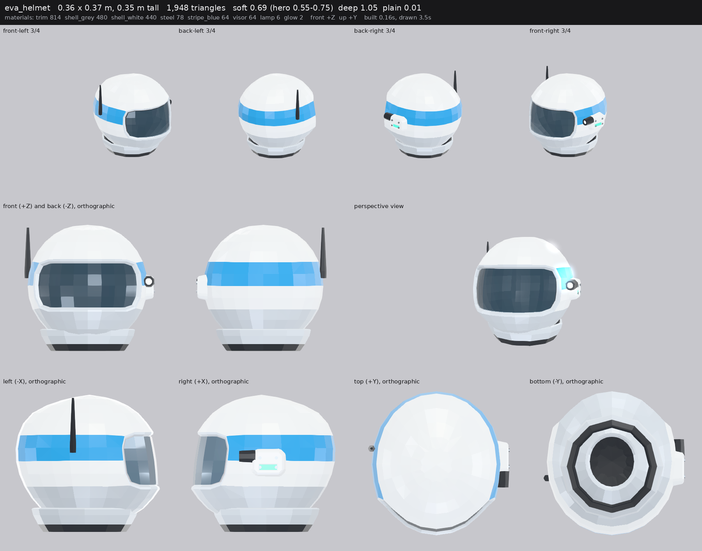
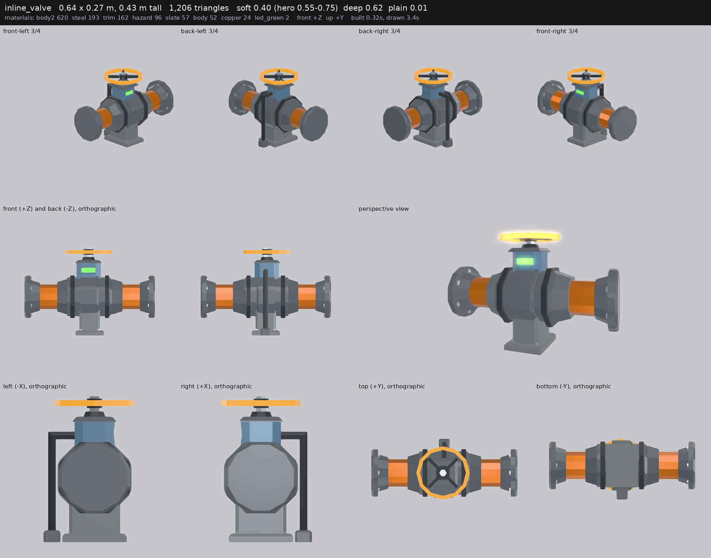
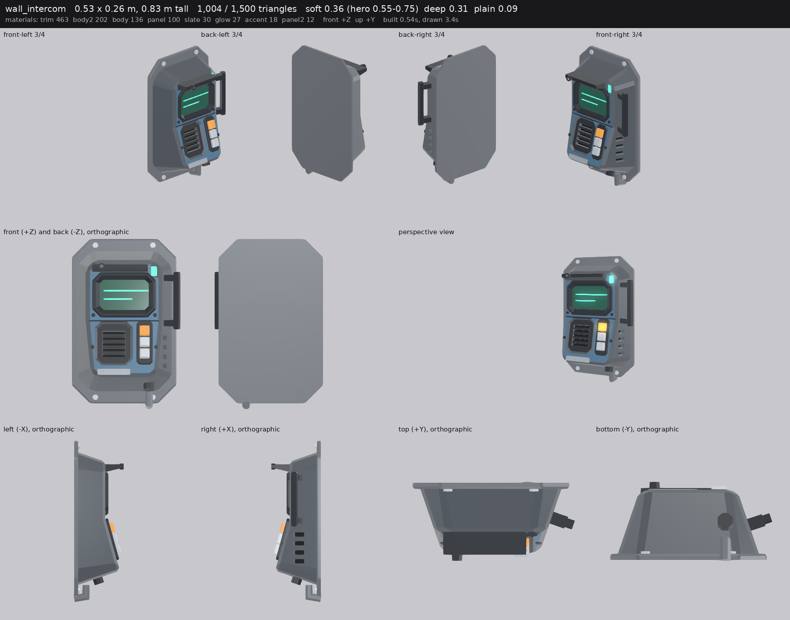

# jig3d

Procedural 3D modelling in short Python scripts, built for AI agents. Hard-surface CSG and Catmull-Clark SubD in one API, compiled to deterministic multi-material PBR **glTF 2.0 (`.glb`)**, with multi-angle contact sheets rendered in seconds. No Blender, no GUI.

- **CAD + SubD**: `extrude`, `loft`, `lathe`, `sweep`, `.chamfer`, `p.cut`, `p.inset`, `p.slots` alongside creased `QuadCage` sculpting.
- **Semantic placement**: `bezel.on(shell.face("front"))`, `with p.mirror("x")`, no hand-computed offsets.
- **Diagnostics**: per-line triangle cost, floating/overhanging part and flush-overlap warnings.
- **Fast feedback**: `jig view` renders 3/4, orthographic and hero views in 2–5 s.

## Install

`pip install jig3d` (or `uv add jig3d`). Rendering needs [`f3d`](https://f3d.app).

From source: Python 3.12+, [`uv`](https://docs.astral.sh/uv/), and [`f3d`](https://f3d.app) for rendering.

```bash
uv sync --extra dev
uv run jig words        # vocabulary with live signatures
```

The package is `jig3d`; the import and CLI are `jig`.

## Usage

```bash
uv run jig new my_model.py                              # scaffold
uv run jig view my_model.py -o out/my_model.png         # render contact sheet
uv run jig describe my_model.py                         # faces, slots, warnings
uv run jig cost my_model.py                             # per-line triangle cost
uv run jig build my_model.py -o out/my_model.glb        # final .glb
```

See [`examples/`](examples) for complete models. Each image below is the `jig view` contact sheet for one example.

[`eva_helmet.py`](examples/eva_helmet.py): creased SubD shell and visor, hard-surface comms pod and headlamp



[`inline_valve.py`](examples/inline_valve.py): one script, three pipe sizes; lathe, sweep, bolted flanges, handwheel



[`wall_intercom.py`](examples/wall_intercom.py): hard-surface panel, screen, speaker grille, keys



## Docs

- [SURFACE.md](SURFACE.md): vocabulary reference
- [AGENTS.md](AGENTS.md): modelling workflow for agents
- [.claude/skills/jig/SKILL.md](.claude/skills/jig/SKILL.md): drop-in agent skill

## License

[GPL-3.0-or-later](LICENSE). Models you create with jig are yours.
